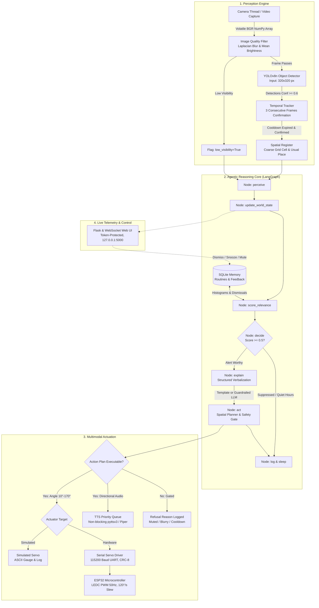

# VigilAI System Architecture & Engineering Specification

**Vishwakarma Awards 2026–27 | Application ID: VK26-AU-HCI-0036**  
**Theme 9: HCI 2.0 (Agentic Hardware & Embodied Intelligent Systems)**

---

## 1. Architectural Philosophy: The Perceive &rarr; Reason &rarr; Act Loop

VigilAI is designed as an autonomous, zero-wake-word embodied desktop companion that provides proactive situational awareness. Unlike passive smart speakers or intrusive surveillance monitors, VigilAI features **no display screen** and requires **no verbal prompting**. It continuously observes its immediate spatial perimeter, filters environmental events through routine memory and contextual heuristics, and acts through a low-inertia physical pointer and directional voice cues.

---

## 2. Perception Pipeline Detailed Specification

1. **Volatile Ingestion (`perception/camera.py`):**
   - OpenCV frames reside strictly in volatile memory.
   - Evaluates frame quality using variance of the Laplacian (detecting lens occlusion or motion blur) and mean pixel luminance (detecting dark/unlit rooms). If blur < 100 or brightness < 40, `low_visibility` is asserted, which activates a safety gate in the planner.
2. **Edge Detector Wrapper (`perception/detector.py`):**
   - Utilizes YOLOv8n operating at a reduced input resolution of **320x320 px** to minimize latency on edge CPUs.
   - Filters candidate predictions at `min_confidence >= 0.60`.
   - Computes normalized bounding box center $(c_x, c_y) \in [0.0, 1.0]$ and maps to coarse $3 \times 3$ grid cells.
3. **Temporal Tracking & Confirmation (`perception/tracker.py`):**
   - Enforces a **3-frame temporal confirmation window**. Transient single-frame flickering detections are discarded.
   - Implements a per-object **120-second cooldown timer**, preventing repetitive auditory nagging.
   - Tracks "usual places" for objects; if an item appears outside its baseline spatial cell, an `object_moved` event is registered.

---

## 3. Agentic State Machine (LangGraph)

The agent is organized as a compiled `StateGraph` with seven distinct nodes:

1. **`perceive`:** Pulls confirmed symbolic detections from perception queue.
2. **`update_world_state`:** Queries current time of day and temporal routine context.
3. **`score_relevance`:** Fast-path heuristic rules engine (`agent/relevance.py`):
   - *Medication Routine Rule:* Detects medication bottle during configured/learned dose hour windows &rarr; High relevance (0.90).
   - *Walking Path Hazard Rule:* Detects obstacles in walking corridors &rarr; High relevance (0.85).
   - *Displaced Object Rule:* Detects items moved from baseline locations &rarr; Medium relevance (0.65).
   - *Feedback Penalty:* Each recent dismissal lowers the score for that label by -0.20.
   - *Quiet Hours Filter:* Non-critical alerts are suppressed between 22:00 and 07:00.
4. **`decide`:** Conditional edge routing; if score $\ge 0.50$ and not suppressed, routes to `explain`; otherwise branches directly to `log`.
5. **`explain`:** Verbalization engine (`agent/explainer.py`). Employs deterministic template strings. When optional LLMs are active, outputs are strictly schema-validated; critical alerts always bypass LLM inference.
6. **`act`:** Spatial planning (`agent/planner.py`). Maps normalized $x$ position to physical servo angle:
   $$\theta = \theta_{\text{center}} + (x_{\text{norm}} - 0.5) \times \text{HFOV}_{\text{deg}}$$
   Clamps to soft limits $[10^\circ, 170^\circ]$, adds direction verbal cues (*"on your left"*), and dispatches actuation and speech queues.
7. **`log`:** Commits symbolic event and decision telemetry to SQLite database (`vigilai_memory.db`) and increments the 24-hour routine histogram.

---

## 4. Hardware Actuation & Safety Envelope

1. **Simulated Actuation First (`actuation/sim_servo.py`):**
   - Out-of-the-box support for laptop-only execution with zero physical hardware attached.
   - Renders live angle gauges and slew rate emulation in the console.
2. **Serial Hardware Actuation (`actuation/serial_servo.py`):**
   - Communicates with ESP32 via UART binary protocol (`0xAA | LEN | CMD | PAYLOAD | CRC8`).
   - Slew rate capped at **120°/s** across both host and firmware.
   - Automatic 200 ms heartbeats satisfy the 500 ms firmware watchdog timer.
